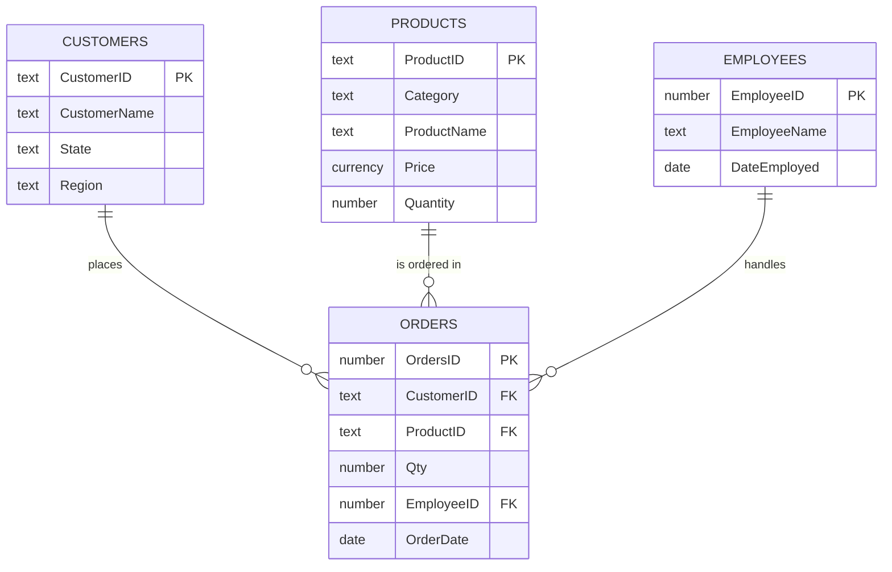

# Retail Orders Database (Microsoft Access)

**A relational database for a small retailer of office supplies, furniture and technology, built in Microsoft Access, with queries, forms and reports for day-to-day order handling.**
Joining the tables shows that Technology products make up only 23 % of orders but 70 % of revenue.

## Business question
How can a small retailer keep its customers, products, orders and staff in one place, keep stock levels correct, and see which products actually bring in the money?

## What I built
| Part | Details |
|------|---------|
| **Tables** | 4 tables: Customers (48), Products (112), Orders (35), Employees (8) |
| **Relationships** | 3 one-to-many relationships: Customers → Orders, Products → Orders, Employees → Orders |
| **Queries** | 6 queries: a parameter query for low stock, two update queries (price increase per category, stock reduction when an order is entered), an append query and two delete queries. See [`sql/access_queries.sql`](sql/access_queries.sql). |
| **Forms** | 5 forms: Customers, Products, Orders and Employees, plus a main navigation form with a category drop-down |
| **Reports** | 2 reports: Low Stock and Orders |

## Key findings
Revenue = order quantity × product price, from Orders joined with Products.

| Category | Share of orders | Share of revenue |
|----------|----------------:|-----------------:|
| Technology | 23 % | 70 % |
| Furniture | 26 % | 21 % |
| Office Supplies | 51 % | 9 % |

- **Technology drives the business.** It has the fewest orders but 70 % of revenue.
- **One product dominates.** A single VoIP phone model (Polycom CX600) generates 60 % of total revenue, which is a concentration risk.
- **Office Supplies are high-volume, low-value.** They make up half of all orders but under 10 % of revenue.

## Files
| File | Content |
|------|---------|
| `retail_orders_database.accdb` | The Access database (tables, relationships, queries, forms, reports) |
| `data/*.csv` | The four tables as CSV, readable without Access |
| `sql/access_queries.sql` | SQL view of all six queries |

**To open the database:** download `retail_orders_database.accdb` and open it in Microsoft Access (Windows). Start with the **Main form**.

## Skills used
Relational database design · primary and foreign keys · one-to-many relationships · select, parameter, update, append and delete queries · Access SQL · forms and navigation · reports

## Background
Built in the **Data Management** module of my B.A. Business Administration with Informatics at **South Westphalia University of Applied Sciences (Fachhochschule Südwestfalen), Soest**, summer semester 2026.
Customer and product records come from the public *Sample – Superstore* dataset (Tableau). The orders and employee records were created for this course exercise.
